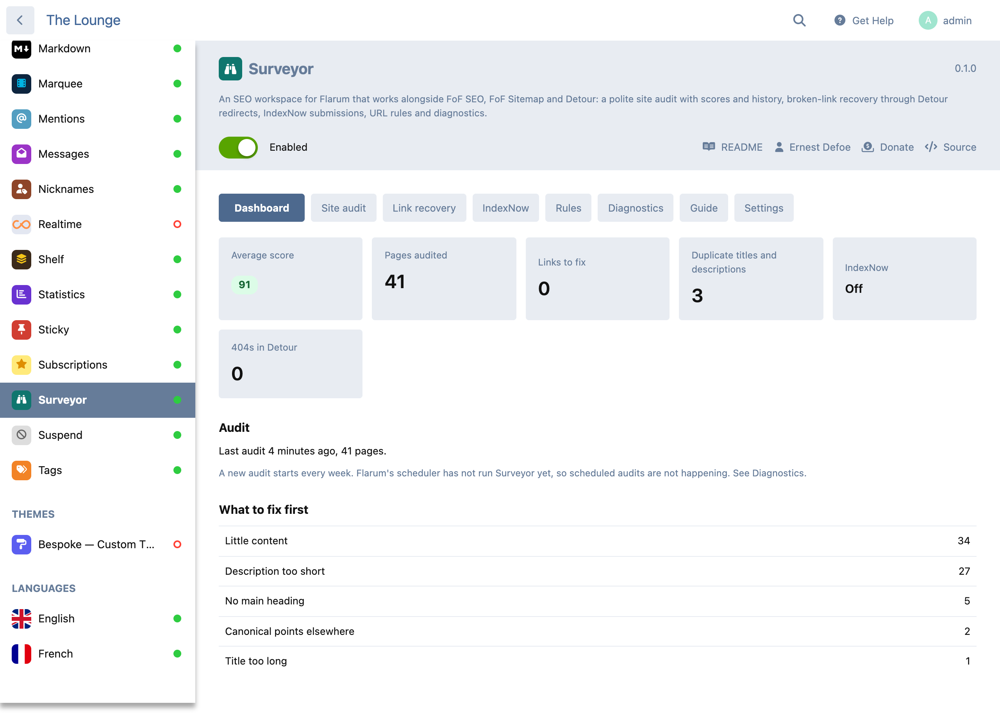

# Surveyor

**An SEO workspace for Flarum 2, built to sit beside FoF SEO, FoF Sitemap and Detour.**

Your forum already has the parts: FoF SEO writes the titles, descriptions, canonical addresses and structured data; FoF Sitemap lists your pages for search engines; Detour keeps your redirects and logs the addresses that 404. What nobody tells you is whether it all *works*: which pages have no description, which links in old posts now lead nowhere, whether robots.txt still points at your sitemap, whether search engines heard about the discussion you started this morning.

Surveyor checks, shows you what to fix first, and fixes it through those extensions. It never writes a meta tag, never keeps a redirect of its own and never builds a sitemap.



## What it does

- **Dashboard.** Your average score and its trend over recent audits, how many pages were checked, links to fix, duplicate titles and descriptions, IndexNow, Detour's 404 count, and the issues found on the most pages, so you know where to start.
- **Site audit.** Surveyor reads robots.txt and your sitemap, then visits each page the way a signed-out visitor would, a few a minute. For every page it records the answer, where it ends up after redirects, title and its length, meta description and its length, canonical address (and whether it points at the page itself), noindex (meta tag or `X-Robots-Tag` header), main headings, words of content, links to your own pages, images without alt text, structured data (and whether it can be read), response time and size. Each page gets a score, and its score history is kept.
- **Duplicates.** Pages that share one title or one description, grouped. Pages whose canonical points elsewhere are left out: they already say they are copies.
- **Link recovery.** Every link on your pages to another page of your forum is checked and grouped by where it goes, with the pages that link there. Broken links (404, 410) get a **Create redirect** button that makes a Detour redirect. Links to pages only members can see are shown as *members only*, not broken. Redirects, security challenges (such as Cloudflare's "Just a moment…") and failed requests are flagged too. Recheck one, or ignore it. Underneath: the addresses Detour has logged as 404 most often.
- **IndexNow.** Tells Bing, Yandex, Seznam, Naver and other IndexNow search engines when a discussion is started, replied to, edited, renamed, hidden, restored or deleted. Batched every five minutes, each discussion at most once an hour, only discussions a guest can see. Send addresses by hand too. (Google does not use IndexNow.)
- **Rules.** Leave parts of the forum out of the audit, IndexNow or both, or limit them to some parts. Exact addresses, wildcards (`/t/staff*`) or regular expressions, with a box to try an address.
- **Diagnostics.** Live checks with an explanation for each: FoF SEO, FoF Sitemap and Detour enabled (and their versions); conflicting extensions; https; the server can reach its own forum; the home page's canonical; the sitemap answers, is valid and lists only your own addresses; robots.txt answers, does not block the forum and lists the sitemap; Flarum's scheduler runs; the IndexNow key file opens; Surveyor's tables exist.
- **Guide.** A short built-in explanation of each section.


## How the score works

Every page starts at 100 and loses points for each problem:

| Problem | Points |
| --- | --- |
| No title | 15 |
| Title under 10 or over 65 characters | 10 |
| No meta description | 15 |
| Description under 50 or over 160 characters | 5 |
| No canonical address | 10 |
| Canonical points at another address | 5 |
| Asks not to be indexed (noindex) | 10 |
| No main heading (h1), or more than one | 10 |
| Under 50 words of content for a guest | 5 |
| Images without alt text | 5 |
| No structured data, or structured data that cannot be read | 5 |
| Slower than 1.5 seconds | 5 |

Only pages that answer 200 with HTML are scored. Duplicates are shown separately and do not change a page's score.

## Requirements

- Flarum 2.0 or later, PHP 8.3 or later
- [FoF SEO](https://github.com/FriendsOfFlarum/seo) 4.0 (beta)
- [FoF Sitemap](https://github.com/FriendsOfFlarum/sitemap) 3.0
- [Detour](https://github.com/ernestdefoe/detour) 1.0
- Flarum's scheduler, for audits and IndexNow to run in the background ([how to set it up](https://docs.flarum.org/scheduler))

Composer installs the three companions for you, and Flarum will not let you enable Surveyor until they are enabled.

## Install

FoF SEO for Flarum 2 is still a beta, so on most forums it has to be asked for by name:

```
composer require fof/seo:"^4.0@beta" ernestdefoe/surveyor
```

Then enable **FoF Sitemap**, **FoF SEO**, **Detour** and **Surveyor** in the admin panel, open Surveyor, and press **Audit now** on the Site audit page.

## Update

```
composer update ernestdefoe/surveyor
php flarum migrate
php flarum cache:clear
```

## Light on your forum

- **Nothing on your pages.** Surveyor adds no JavaScript, CSS or data to the forum, and not one database query to a page view or an API request. (Its tests measure the discussion list and `/api/discussions`, as a guest and as an admin, with 1 and with 20 discussions, Surveyor on and off: the same queries every time.) The admin page loads its workspace only when you open it.
- **Gentle crawling.** By default 20 pages a minute (one every three seconds), at most 500 pages per audit, a 10 second limit per page, 2 MB read per page at most. A big forum is covered over several audits: each one starts with pages never checked, then those checked longest ago.
- **IndexNow costs one small database write** when a discussion changes, and nothing at all while IndexNow is off.
- **History is pruned.** The last 12 audits are kept; pages that no longer appear anywhere are forgotten after three audits.

## Safe by design

- **It only visits your own forum.** Same scheme, host and port as your forum's address, inside its folder if it lives in one. Redirects to anywhere else are recorded, never followed. External links in posts are never requested.
- **As a guest, politely.** No cookies, a clear user agent (`Surveyor/<version> (+your forum's address)`), robots.txt obeyed (a group for `Surveyor` if you write one, else `*`), and private pages never visited: settings, notifications, admin, the API, sign in and sign up, password reset, email confirmation, messages.
- **Nothing private reaches IndexNow.** Only discussions a guest can see are sent. A discussion that becomes hidden or private is sent once more only if its address was public before, so search engines drop it; an address never sent is never revealed.
- **Text only.** Titles and descriptions from your pages are shown as text, never as HTML.
- **Admins only.** Every Surveyor endpoint refuses everyone else.
- **Redirects go through Detour's own checks**, so Surveyor can never make one Detour would refuse (another host, the home page, a loop).
- **Regular expressions can't hang the forum.** Up to 300 characters, nested repeats refused, and a hard backtracking limit on every match.

## Settings

| Setting | Default | What it does |
| --- | --- | --- |
| Start a new audit | Every week | Daily, weekly, monthly, or only when you press Audit now |
| Pages per audit | 500 | The most pages one audit checks |
| Pages per minute | 20 | How fast an audit goes |
| Wait for a page | 10 seconds | Longer than this, and the page is recorded as failed (2–20) |
| Audits of history to keep | 12 | Older score history is removed |

IndexNow is switched on and off in its own section; turning it on makes a random key and serves it at `/<key>.txt`.

## Troubleshooting

**The audit never moves.** Audits run from Flarum's scheduler: `* * * * * cd /path/to/flarum && php flarum schedule:run >> /dev/null 2>&1` in cron. Diagnostics says whether it runs. Until it does, an audit you start keeps going while its admin page is open (**Continue in this tab**), or run `php flarum surveyor:audit --start` yourself.

**"The server cannot fetch the forum's home page".** Surveyor fetches pages from your forum's own address (the `url` in `config.php`). Check that address is right, and that the server can reach itself on it; some hosts and firewalls block this. PHP's built-in server (`php -S`) answers one request at a time, so on a test install started that way the checks and the in-tab audit wait on themselves; use the console command there, or start it with `PHP_CLI_SERVER_WORKERS=4`.

**robots.txt or the IndexNow key file doesn't open.** FoF Sitemap answers `/robots.txt` and Surveyor answers `/<key>.txt`, but only if the request reaches Flarum. Some nginx setups answer every `.txt` address from disk. Let these reach Flarum's `index.php` (or put the files there yourself, with the same content).

**Every link to a private discussion shows as "members only".** That is right: guests can't open them, so search engines can't either. They are not broken. Ignore them, or move the links.

**IndexNow says 403.** The search engine could not open your key file. Fix that first (see above); Surveyor waits six hours after a 403, and an hour after a 429.

**Another IndexNow extension is enabled.** Diagnostics warns about it: both would send every change. Disable one.

## Links

- [Source](https://github.com/ernestdefoe/surveyor)
- [Report an issue](https://github.com/ernestdefoe/surveyor/issues)
